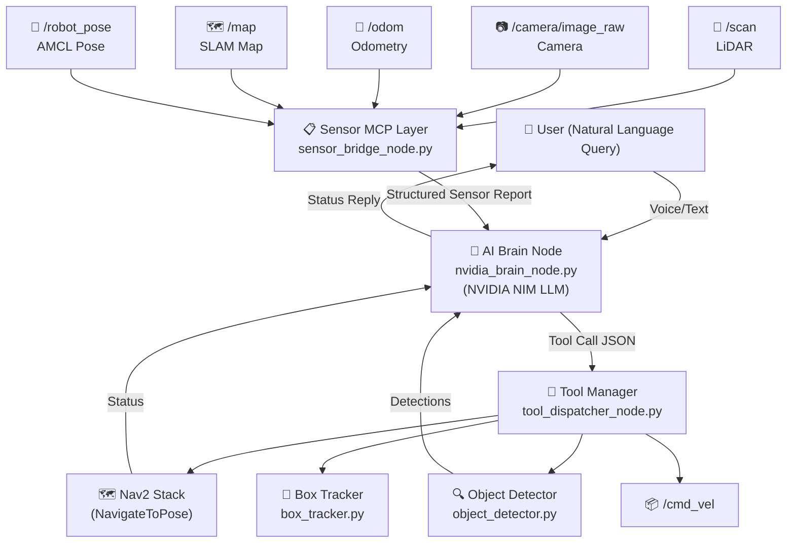

# 🧠 Autonomous Hexapod Brain — NVIDIA API Integration Plan

> **Stack**: ROS2 Humble · Gazebo Sim · Nav2 · SLAM Toolbox · NVIDIA NIM (LLM) · LangChain/OpenAI-compat client

---

## 🗺️ Architecture Overview



---

## 🔑 Key Design Decisions

| Decision | Choice | Reason |
|---|---|---|
| LLM Backend | **NVIDIA NIM** (`meta/llama-3.1-70b-instruct` or `nvidia/llama-3.1-nemotron-70b-instruct`) | OpenAI-compatible API, best reasoning, free tier available |
| Tool Calling | **OpenAI Function Calling format** (NIM supports this natively) | Structured, reliable, no prompt parsing needed |
| Sensor Context | **ROS2 service** that serializes latest sensor snapshot | LLM gets fresh grounded state per query |
| Memory | **Short conversation history** (last 5 turns) in node | Continuity for multi-step tasks |
| Navigation | **Nav2 NavigateToPose action client** | Proven, obstacle-aware |
| Sim Target | **Gazebo Sim** with existing `sim_navigation.launch.py` | Ready-to-use world + sensors |

---

## 📦 New Files to Create

```
src/rover/rover/
├── nvidia_brain_node.py        ← Main AI agent node (NEW)
├── sensor_bridge_node.py       ← Sensor aggregation & snapshot service (NEW)
├── tool_dispatcher_node.py     ← Translates LLM tool calls → ROS2 actions (NEW)
└── [existing nodes unchanged]

src/rover/launch/
└── autonomous.launch.py        ← Launches full autonomous stack (NEW)

src/rover/config/
└── brain_config.yaml           ← API key path, model name, tool list (NEW)
```

---

## 📐 Phase-by-Phase Implementation

---

### Phase 1 — Sensor Bridge Node (`sensor_bridge_node.py`)

**Purpose**: Aggregate all sensor feeds and serve a structured JSON snapshot to the LLM brain on demand.

**ROS2 Subscriptions:**

| Topic | Message Type | Usage |
|---|---|---|
| `/scan` | `sensor_msgs/LaserScan` | Obstacle detection, nearest obstacle distance |
| `/odom` | `nav_msgs/Odometry` | Current position (x, y) and heading |
| `/camera/camera/image_raw` | `sensor_msgs/Image` | Camera frame (converted to base64 for multimodal, or object detection result) |
| `/map` | `nav_msgs/OccupancyGrid` | Map availability status |
| `/amcl_pose` | `geometry_msgs/PoseWithCovarianceStamped` | Localized pose (if AMCL active) |

**ROS2 Service (served):**

```
/get_sensor_snapshot  →  rover_interfaces/srv/SensorSnapshot
  Response:
    string json_data   # JSON blob with all sensor state
```

**Sample JSON snapshot emitted:**
```json
{
  "timestamp": "2026-10-12T03:48:41",
  "position": {"x": 1.23, "y": -0.45, "heading_deg": 87.3},
  "nearest_obstacle_m": 0.82,
  "lidar_sectors": {
    "front": 0.82, "left": 2.1, "right": 1.5, "back": 3.0
  },
  "camera": {
    "objects_detected": ["red_box"],
    "description": "Red box at pixel (320, 240), area=15000"
  },
  "map_ready": true,
  "nav2_status": "idle"
}
```

**Implementation notes:**
- Use `CvBridge` + existing `object_detector` logic inline for camera summary
- LiDAR sector split: front=±30°, left=30°–150°, right=-30° to -150°, back=±150°–180°
- Keep last 1s rolling average for LiDAR to debounce noise

---

### Phase 2 — Tool Dispatcher Node (`tool_dispatcher_node.py`)

**Purpose**: Receive tool call decisions from the brain and execute them as ROS2 actions/topics.

**Exposed tools (as ROS2 service):**

```
/execute_tool  →  rover_interfaces/srv/ExecuteTool
  Request:
    string tool_name
    string args_json    # JSON-encoded arguments
  Response:
    bool success
    string result_json  # JSON-encoded result
```

**Tool Catalog:**

| Tool Name | Args | What it does |
|---|---|---|
| `navigate_to_pose` | `{x, y, yaw_deg}` | Sends Nav2 `NavigateToPose` action goal |
| `navigate_to_named_location` | `{name}` | Resolves predefined waypoints (e.g. "home", "charging_dock") |
| `cancel_navigation` | `{}` | Cancels current Nav2 goal |
| `get_navigation_status` | `{}` | Returns `{status, remaining_distance}` |
| `find_object` | `{color, max_search_time_s}` | Activates `box_tracker` node for N seconds |
| `approach_object` | `{color}` | Activates `box_tracker` in approach mode |
| `stop` | `{}` | Publishes zero `cmd_vel` immediately |
| `rotate_in_place` | `{degrees, speed}` | Publishes angular cmd_vel for rotation |
| `get_sensor_snapshot` | `{}` | Returns current sensor state |
| `say` | `{message}` | Logs response to user (published on `/brain/response`) |

**Nav2 Action Client pattern:**
```python
# Inside tool_dispatcher_node.py
self._nav_client = ActionClient(self, NavigateToPose, 'navigate_to_pose')

def _tool_navigate(self, x, y, yaw_rad):
    goal = NavigateToPose.Goal()
    goal.pose.header.frame_id = 'map'
    goal.pose.pose.position.x = x
    goal.pose.pose.position.y = y
    goal.pose.pose.orientation = euler_to_quaternion(0, 0, yaw_rad)
    self._nav_client.send_goal_async(goal)
```

---

### Phase 3 — NVIDIA Brain Node (`nvidia_brain_node.py`)

**Purpose**: The actual LLM reasoning loop. Subscribes to user queries, fetches sensor state, calls NVIDIA NIM, interprets tool calls, dispatches them.

#### 3a. NVIDIA NIM API Setup

```python
from openai import OpenAI   # NIM uses OpenAI-compatible API

client = OpenAI(
    base_url="https://integrate.api.nvidia.com/v1",
    api_key=os.environ["NVIDIA_API_KEY"]   # loaded from env or brain_config.yaml
)
```

**Recommended models (pick one):**
- `meta/llama-3.1-70b-instruct` — Best general reasoning, free credits
- `nvidia/llama-3.1-nemotron-70b-instruct` — Fine-tuned for instruction following  
- `nvidia/nemotron-4-340b-instruct` — Largest, best for complex multi-step tasks

#### 3b. System Prompt Design

```
You are the autonomous brain of a 6-legged hexapod robot operating in a Gazebo simulation.
You have access to the following tools to control the robot and gather information.
Always think step-by-step before calling tools. 
After completing a task, summarize what you did.

Robot capabilities:
- Navigate to any (x, y) coordinate on the map using Nav2
- Detect and track colored objects using the camera  
- Rotate in place
- Stop immediately
- Get real-time sensor readings (LiDAR, odometry, camera)

Current map: Gazebo sim_world.sdf (indoor environment)
```

#### 3c. Tool Schema (OpenAI Function Calling Format)

```python
TOOLS = [
    {
        "type": "function",
        "function": {
            "name": "navigate_to_pose",
            "description": "Navigate the robot to a specific (x,y) map coordinate",
            "parameters": {
                "type": "object",
                "properties": {
                    "x": {"type": "number", "description": "X coordinate in map frame (meters)"},
                    "y": {"type": "number", "description": "Y coordinate in map frame (meters)"},
                    "yaw_deg": {"type": "number", "description": "Heading angle in degrees (0=East)"}
                },
                "required": ["x", "y"]
            }
        }
    },
    {
        "type": "function",
        "function": {
            "name": "get_sensor_snapshot",
            "description": "Get the current state of all robot sensors (LiDAR, camera, odometry, map)",
            "parameters": {"type": "object", "properties": {}}
        }
    },
    {
        "type": "function",
        "function": {
            "name": "find_object",
            "description": "Search for an object of a given color using the camera",
            "parameters": {
                "type": "object",
                "properties": {
                    "color": {"type": "string", "enum": ["red", "blue", "green", "yellow"]},
                    "max_search_time_s": {"type": "number", "default": 10.0}
                },
                "required": ["color"]
            }
        }
    },
    # ... (all tools from Phase 2 catalog)
]
```

#### 3d. ROS2 Node Structure

```python
class NvidiaBrainNode(Node):
    def __init__(self):
        super().__init__('nvidia_brain')
        
        # Sub: user queries via topic (string messages)
        self.query_sub = self.create_subscription(
            String, '/brain/query', self.on_query, 10)
        
        # Pub: brain responses
        self.response_pub = self.create_publisher(
            String, '/brain/response', 10)
        
        # Service clients
        self.sensor_cli = self.create_client(SensorSnapshot, '/get_sensor_snapshot')
        self.tool_cli = self.create_client(ExecuteTool, '/execute_tool')
        
        # Conversation memory (rolling window)
        self.history = []   # list of {role, content} dicts
        self.MAX_HISTORY = 10  # 5 turns
        
        # NVIDIA NIM client
        self.llm = OpenAI(
            base_url="https://integrate.api.nvidia.com/v1",
            api_key=self._load_api_key()
        )
        self.model = "meta/llama-3.1-70b-instruct"
```

#### 3e. Reasoning Loop

```
User Query
    │
    ▼
[1] Fetch sensor snapshot via /get_sensor_snapshot
    │
    ▼
[2] Build message list:
    system_prompt + sensor_context + history + user_query
    │
    ▼
[3] Call NVIDIA NIM API (with tools)
    │
    ├─ Model returns text? → publish to /brain/response, done
    │
    └─ Model returns tool_calls?
         │
         ├─ Dispatch tool via /execute_tool service
         ├─ Append tool result to history
         └─ Loop back to [3] (agentic loop, max 5 iterations)
```

**Code sketch:**
```python
async def on_query(self, msg: String):
    user_query = msg.data
    sensor_ctx = await self._get_sensor_snapshot()
    
    messages = [
        {"role": "system", "content": SYSTEM_PROMPT},
        {"role": "system", "content": f"[SENSOR STATE]\n{sensor_ctx}"},
        *self.history[-self.MAX_HISTORY:],
        {"role": "user", "content": user_query}
    ]
    
    for _ in range(5):   # max agentic iterations
        response = self.llm.chat.completions.create(
            model=self.model,
            messages=messages,
            tools=TOOLS,
            tool_choice="auto",
            max_tokens=1024,
            temperature=0.3   # low temp for reliable tool calls
        )
        
        choice = response.choices[0]
        
        if choice.finish_reason == "tool_calls":
            for tc in choice.message.tool_calls:
                result = await self._dispatch_tool(tc.function.name, tc.function.arguments)
                messages.append({"role": "tool", "tool_call_id": tc.id, "content": result})
        else:
            final = choice.message.content
            self.response_pub.publish(String(data=final))
            self.history.extend([
                {"role": "user", "content": user_query},
                {"role": "assistant", "content": final}
            ])
            break
```

---

### Phase 4 — Custom ROS2 Interfaces (`rover_interfaces` package)

Create a new interface package:

```
src/rover_interfaces/
├── package.xml
├── CMakeLists.txt
└── srv/
    ├── SensorSnapshot.srv   ← Returns JSON sensor state
    └── ExecuteTool.srv      ← Dispatches a tool call
```

**`SensorSnapshot.srv`:**
```
---
string json_data
bool success
```

**`ExecuteTool.srv`:**
```
string tool_name
string args_json
---
bool success
string result_json
string error_message
```

---

### Phase 5 — Launch File (`autonomous.launch.py`)

```python
# autonomous.launch.py
# Extends sim_navigation.launch.py with the AI brain stack

def generate_launch_description():
    # ... include sim_navigation.launch.py ...
    
    sensor_bridge = Node(
        package='rover',
        executable='sensor_bridge',
        name='sensor_bridge_node',
        output='screen',
        parameters=[{'use_sim_time': True}]
    )
    
    tool_dispatcher = Node(
        package='rover',
        executable='tool_dispatcher',
        name='tool_dispatcher_node',
        output='screen',
        parameters=[{'use_sim_time': True}]
    )
    
    brain_node = Node(
        package='rover',
        executable='nvidia_brain',
        name='nvidia_brain_node',
        output='screen',
        parameters=[{
            'use_sim_time': True,
            'model': 'meta/llama-3.1-70b-instruct',
            'max_iterations': 5,
        }]
    )
    
    return LaunchDescription([
        # ... existing sim launch nodes ...
        TimerAction(period=20.0, actions=[sensor_bridge]),   # after Nav2 ready
        TimerAction(period=21.0, actions=[tool_dispatcher]),
        TimerAction(period=22.0, actions=[brain_node]),
    ])
```

---

### Phase 6 — Configuration (`brain_config.yaml`)

```yaml
nvidia_brain_node:
  ros__parameters:
    nvidia_api_key_env: "NVIDIA_API_KEY"    # env var name (never hardcode key)
    model: "meta/llama-3.1-70b-instruct"
    temperature: 0.3
    max_tokens: 1024
    max_agentic_iterations: 5
    history_length: 10

sensor_bridge_node:
  ros__parameters:
    lidar_sector_front_deg: 30.0
    object_detection_enabled: true
    snapshot_cache_sec: 0.5               # cache for 500ms to avoid hammering LLM

tool_dispatcher_node:
  ros__parameters:
    nav2_timeout_sec: 30.0
    rotation_speed_rad_s: 0.5
    predefined_waypoints:
      home: [0.0, 0.0, 0.0]
      inspect_point: [2.0, 1.5, 90.0]
```

---

## 🧪 Testing Plan

### Stage 1 — Sensor Bridge Validation
```bash
# In terminal 1 — launch sim + brain stack
ros2 launch rover autonomous.launch.py

# In terminal 2 — manually call sensor snapshot
ros2 service call /get_sensor_snapshot rover_interfaces/srv/SensorSnapshot "{}"
```
**Pass criteria:** Returns valid JSON with position, lidar sectors, camera state.

### Stage 2 — Tool Dispatcher Validation
```bash
# Test navigate tool
ros2 service call /execute_tool rover_interfaces/srv/ExecuteTool \
  "{tool_name: 'navigate_to_pose', args_json: '{\"x\": 2.0, \"y\": 1.0}'}"
```
**Pass criteria:** Robot walks to (2, 1) in Gazebo.

### Stage 3 — End-to-End Brain Queries
```bash
# Send natural language query
ros2 topic pub /brain/query std_msgs/msg/String \
  "{data: 'Go to position x=2, y=1 and look for a red object'}"

# Monitor response
ros2 topic echo /brain/response
```

**Test query battery:**
| Query | Expected Behavior |
|---|---|
| "Where are you right now?" | Returns current (x, y, heading) |
| "Go to position 2, 1" | Nav2 goal sent, robot walks there |
| "Find the red box" | Camera scan + box_tracker activated |
| "Stop immediately" | Zero cmd_vel published |
| "How close is the nearest obstacle?" | Returns LiDAR front sector distance |
| "Explore the room and come back to origin" | Multi-step: rotate, move, return |

---

## 🔒 Security & Key Management

> [!CAUTION]
> Never hardcode the NVIDIA API key in source files or YAML configs.

```bash
# Set before launching:
export NVIDIA_API_KEY="nvapi-xxxxxxxxxxxx"
ros2 launch rover autonomous.launch.py
```

The `nvidia_brain_node.py` reads it via:
```python
api_key = os.environ.get("NVIDIA_API_KEY")
if not api_key:
    self.get_logger().fatal("NVIDIA_API_KEY env var not set!")
    raise RuntimeError("Missing NVIDIA_API_KEY")
```

---

## 📦 Dependencies to Install

```bash
# Python packages
pip install openai                 # NVIDIA NIM uses OpenAI-compat API
pip install langchain              # optional, for more complex agent patterns

# ROS2 packages (already present in your workspace):
# - nav2_msgs (NavigateToPose action)
# - sensor_msgs, geometry_msgs, nav_msgs (sensor topics)
# - cv_bridge, opencv (camera processing)
```

---

## 🗓️ Implementation Order

```
Week 1:
  ✅ Day 1-2: Create rover_interfaces package (SensorSnapshot + ExecuteTool srv)
  ✅ Day 3-4: Implement sensor_bridge_node.py — subscribe, aggregate, serve snapshots
  ✅ Day 5:   Test sensor bridge with ros2 service call

Week 2:
  ✅ Day 1-2: Implement tool_dispatcher_node.py — all 10 tools
  ✅ Day 3:   Wire Nav2 action client inside tool dispatcher
  ✅ Day 4-5: Test each tool manually

Week 3:
  ✅ Day 1-2: Implement nvidia_brain_node.py — NIM API + tool loop
  ✅ Day 3:   autonomous.launch.py + brain_config.yaml
  ✅ Day 4-5: End-to-end testing with 6-query battery above

Week 4:
  ✅ Polish: error handling, reconnect logic, logging
  ✅ Add multimodal: send camera image to NIM for visual Q&A (optional)
  ✅ Real robot migration plan
```

---

## 🚀 Future Extensions (Post-Sim)

| Feature | Description |
|---|---|
| **Multimodal vision** | Send base64 camera frames to `nvidia/llava` model for visual Q&A |
| **Voice interface** | Add `ros2-speech` → `/brain/query` STT bridge |
| **Long-term memory** | Store waypoints + object locations in a YAML map, feed to LLM |
| **NVIDIA Jetson deploy** | Run NIM locally on Jetson Orin for low-latency inference |
| **Multi-robot** | Each robot has own brain node; central orchestrator brain |

---

> [!NOTE]
> Get your free NVIDIA NIM API key at https://build.nvidia.com — you get 1,000 free credits to start.
> The `meta/llama-3.1-70b-instruct` model is recommended: it supports function calling natively and is available on free tier.
